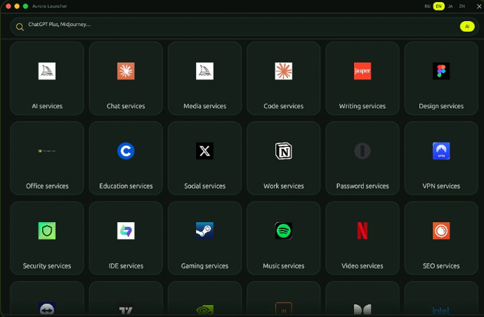

# Windows VPN, antivirus and password apps — paid plans free in Aivora 2026

> **These apps are paid everywhere. In our Aivora launcher the same paid plans are free.**
>
> Official site / app store = paid Plus / Pro / Premium / Total. Aivora launcher = that paid product, free on Windows 10 / 11.

**Keywords:** Proton VPN · ESET Smart Security · VyprVPN · Bitwarden Premium · Hide.me vpn · Proton Pass Plus · Mozilla VPN · Bitdefender Total Security · Ivacy vpn · LastPass Premium · ZenMate vpn · Dashlane Premium · VPN Unlimited · Keeper Unlimited · Norton VPN · Kaspersky Total Security · Kaspersky VPN · Proton Mail Plus · paid apps free through launcher · Aivora Programs

Windows 10 / 11 · VPN · antivirus · password managers · Proton Mail · Aivora Programs

The orange button opens [https://aivoraprograms.com/](https://aivoraprograms.com/). Install Aivora, then **Activate** the card you need. You get the **paid** product **for free in our launcher**. No vendor keys and no `.exe` packs in this repository.

## What this page is

This is one Windows notes page for **eighteen paid apps** people search as separate products: Proton VPN, ESET Smart Security, VyprVPN, Bitwarden Premium, Hide.me, Proton Pass Plus, Mozilla VPN, Bitdefender Total Security, Ivacy, LastPass Premium, ZenMate, Dashlane Premium, VPN Unlimited, Keeper Unlimited, Norton VPN, Kaspersky Total Security, Kaspersky VPN, Proton Mail Plus.

Each one is a **paid** SKU on the vendor site. **In our Aivora launcher** that same paid SKU is **free**. It is not the official free tier (free Proton VPN servers, free Bitwarden without TOTP, free LastPass device cap, free Proton Mail 1 GB, free ESET online scanner).

## Paid plan on each card

| App | Paid plan | What the card is | In Aivora |
| --- | --- | --- | --- |
| **Proton VPN** | Plus | Secure Core, Swiss hop, not the official free servers | Same paid Plus, free here |
| **ESET Smart Security** | Premium | UEFI scanner and banking protection | Same paid Premium, free here |
| **VyprVPN** | Pro | Chameleon protocol on hostile Wi-Fi | Same paid Pro, free here |
| **Bitwarden** | Premium | TOTP in the item and emergency access | Same paid Premium, free here |
| **Hide.me VPN** | Pro | Stealth Guard and split tunneling | Same paid Pro, free here |
| **Proton Pass** | Plus | Hide-my-email aliases and passkeys | Same paid Plus, free here |
| **Mozilla VPN** | Pro | Device-level WireGuard, not a Firefox add-on | Same paid Pro, free here |
| **Bitdefender Total Security** | Total | 5-layer ransomware shield | Same paid Total, free here |
| **Ivacy VPN** | Pro | Split tunneling and P2P locations | Same paid Pro, free here |
| **LastPass** | Premium | Unlimited devices and dark web monitoring | Same paid Premium, free here |
| **ZenMate VPN** | Pro | German client, 74 locations | Same paid Pro, free here |
| **Dashlane** | Premium | Passkeys and a built-in VPN extra | Same paid Premium, free here |
| **VPN Unlimited** | Pro | KeepSolid Wise DNS, 500+ servers | Same paid Pro, free here |
| **Keeper** | Unlimited | BreachWatch and 10 GB secure files | Same paid Unlimited, free here |
| **Norton VPN** | Pro | No-log tunnel, not Norton 360 Deluxe | Same paid Pro, free here |
| **Kaspersky Total Security** | Total | Anti-spyware, parental, password extra | Same paid Total, free here |
| **Kaspersky VPN** | Pro | AES-256, 2000+ servers, auto Wi-Fi | Same paid Pro, free here |
| **Proton Mail** | Plus | Custom domain, 15 GB, not free 1 GB | Same paid Plus, free here |

## How to open a paid app free

1. Download Aivora from [https://aivoraprograms.com/](https://aivoraprograms.com/).
2. Install on Windows 10 or Windows 11.
3. Find the card (VPN, Antivirus, or Passwords / Proton).
4. Press **Activate**. The paid plan from the table starts in the launcher.

This git page is notes and a download link to the homepage. It is not an official vendor store and not a free SKU from Proton, ESET, Bitdefender, or Kaspersky.

## VPN, antivirus and vault notes

### Proton VPN Plus for Windows

Secure Core, Swiss hop, not the official free servers. Official site / store = paid **Plus**. In **our Aivora launcher** that same paid Plus is **free** on Windows 10 / 11.

After **Activate Proton VPN**, you get the paid VPN product. This repository does not ship `ProtonVPN.exe`.

### ESET Smart Security Premium for Windows

UEFI scanner and banking protection. Official site / store = paid **Premium**. In **our Aivora launcher** that same paid Premium is **free** on Windows 10 / 11.

After **Activate ESET Smart Security**, you get the paid Antivirus product. This repository does not ship `ESETSmartSecurity.exe`.

### VyprVPN Pro for Windows

Chameleon protocol on hostile Wi-Fi. Official site / store = paid **Pro**. In **our Aivora launcher** that same paid Pro is **free** on Windows 10 / 11.

After **Activate VyprVPN**, you get the paid VPN product. This repository does not ship `VyprVPN.exe`.

### Bitwarden Premium for Windows

TOTP in the item and emergency access. Official site / store = paid **Premium**. In **our Aivora launcher** that same paid Premium is **free** on Windows 10 / 11.

After **Activate Bitwarden**, you get the paid Passwords / Proton product. This repository does not ship `Bitwarden.exe`.

### Hide.me VPN Pro for Windows

Stealth Guard and split tunneling. Official site / store = paid **Pro**. In **our Aivora launcher** that same paid Pro is **free** on Windows 10 / 11.

After **Activate Hide.me VPN**, you get the paid VPN product. This repository does not ship `Hide.meVPN.exe`.

### Proton Pass Plus for Windows

Hide-my-email aliases and passkeys. Official site / store = paid **Plus**. In **our Aivora launcher** that same paid Plus is **free** on Windows 10 / 11.

After **Activate Proton Pass**, you get the paid Passwords / Proton product. This repository does not ship `ProtonPass.exe`.

### Mozilla VPN Pro for Windows

Device-level WireGuard, not a Firefox add-on. Official site / store = paid **Pro**. In **our Aivora launcher** that same paid Pro is **free** on Windows 10 / 11.

After **Activate Mozilla VPN**, you get the paid VPN product. This repository does not ship `MozillaVPN.exe`.

### Bitdefender Total Security Total for Windows

5-layer ransomware shield. Official site / store = paid **Total**. In **our Aivora launcher** that same paid Total is **free** on Windows 10 / 11.

After **Activate Bitdefender Total Security**, you get the paid Antivirus product. This repository does not ship `BitdefenderTotalSecurity.exe`.

### Ivacy VPN Pro for Windows

Split tunneling and P2P locations. Official site / store = paid **Pro**. In **our Aivora launcher** that same paid Pro is **free** on Windows 10 / 11.

After **Activate Ivacy VPN**, you get the paid VPN product. This repository does not ship `IvacyVPN.exe`.

### LastPass Premium for Windows

Unlimited devices and dark web monitoring. Official site / store = paid **Premium**. In **our Aivora launcher** that same paid Premium is **free** on Windows 10 / 11.

After **Activate LastPass**, you get the paid Passwords / Proton product. This repository does not ship `LastPass.exe`.

### ZenMate VPN Pro for Windows

German client, 74 locations. Official site / store = paid **Pro**. In **our Aivora launcher** that same paid Pro is **free** on Windows 10 / 11.

After **Activate ZenMate VPN**, you get the paid VPN product. This repository does not ship `ZenMateVPN.exe`.

### Dashlane Premium for Windows

Passkeys and a built-in VPN extra. Official site / store = paid **Premium**. In **our Aivora launcher** that same paid Premium is **free** on Windows 10 / 11.

After **Activate Dashlane**, you get the paid Passwords / Proton product. This repository does not ship `Dashlane.exe`.

### VPN Unlimited Pro for Windows

KeepSolid Wise DNS, 500+ servers. Official site / store = paid **Pro**. In **our Aivora launcher** that same paid Pro is **free** on Windows 10 / 11.

After **Activate VPN Unlimited**, you get the paid VPN product. This repository does not ship `VPNUnlimited.exe`.

### Keeper Unlimited for Windows

BreachWatch and 10 GB secure files. Official site / store = paid **Unlimited**. In **our Aivora launcher** that same paid Unlimited is **free** on Windows 10 / 11.

After **Activate Keeper**, you get the paid Passwords / Proton product. This repository does not ship `Keeper.exe`.

### Norton VPN Pro for Windows

No-log tunnel, not Norton 360 Deluxe. Official site / store = paid **Pro**. In **our Aivora launcher** that same paid Pro is **free** on Windows 10 / 11.

After **Activate Norton VPN**, you get the paid VPN product. This repository does not ship `NortonVPN.exe`.

### Kaspersky Total Security Total for Windows

Anti-spyware, parental, password extra. Official site / store = paid **Total**. In **our Aivora launcher** that same paid Total is **free** on Windows 10 / 11.

After **Activate Kaspersky Total Security**, you get the paid Antivirus product. This repository does not ship `KasperskyTotalSecurity.exe`.

### Kaspersky VPN Pro for Windows

AES-256, 2000+ servers, auto Wi-Fi. Official site / store = paid **Pro**. In **our Aivora launcher** that same paid Pro is **free** on Windows 10 / 11.

After **Activate Kaspersky VPN**, you get the paid VPN product. This repository does not ship `KasperskyVPN.exe`.

### Proton Mail Plus for Windows

Custom domain, 15 GB, not free 1 GB. Official site / store = paid **Plus**. In **our Aivora launcher** that same paid Plus is **free** on Windows 10 / 11.

After **Activate Proton Mail**, you get the paid Passwords / Proton product. This repository does not ship `ProtonMail.exe`.

## Who this Windows page is for

People searching **Proton VPN windows**, **ESET Smart Security free**, **Bitwarden Premium**, **Hide.me vpn**, **Kaspersky Total Security**, **Proton Mail Plus**, or **VPN Unlimited** who want the **paid** plan, not the official free cap. Same for VyprVPN Chameleon, Mozilla WireGuard, Bitdefender ransomware layers, LastPass unlimited devices, Dashlane passkeys, Keeper BreachWatch, Norton VPN (not 360), Kaspersky VPN.

## FAQ

**Is this one official free bundle from the vendors?**  
No. Each row is a paid plan. Aivora opens that paid plan for free in the launcher. It is not an official free SKU.

**Do I pick only one app?**  
No. After the launcher is installed you activate the cards you need. VPN, antivirus and password vaults are different tiles.

**Is Norton VPN the same as Norton 360?**  
No. Norton VPN is the tunnel card. 360 Deluxe is antivirus.

**Is Kaspersky VPN the same as Kaspersky Total Security?**  
No. Total Security is the antivirus suite. Kaspersky VPN is the tunnel.

**Is Proton Mail the same as Proton Pass or Proton VPN?**  
No. Mail is the inbox. Pass is the vault. VPN is the tunnel. Three cards.

**Are there keys or installers in this repository?**  
No. The orange button goes to [https://aivoraprograms.com/](https://aivoraprograms.com/). Activate inside Aivora.

---

# VPN, антивирусы и менеджеры паролей для Windows — платные планы бесплатно в Aivora 2026

> **Везде эти приложения платные. В нашем лаунчере Aivora те же платные планы — бесплатно.**
>
> Официальный сайт / магазин = платная Plus / Pro / Premium / Total. Лаунчер Aivora = этот же платный продукт, бесплатно на Windows 10 / 11.

**Ключевые слова:** Proton VPN · ESET · VyprVPN · Bitwarden · Hide.me · Proton Pass · Mozilla VPN · Bitdefender · Ivacy · LastPass · ZenMate · Dashlane · VPN Unlimited · Keeper · Norton VPN · Kaspersky · Proton Mail · платные приложения бесплатно через лаунчер · Aivora Programs

Windows 10 / 11 · VPN · антивирусы · менеджеры паролей · Proton Mail · Aivora Programs

Оранжевая кнопка открывает [https://aivoraprograms.com/](https://aivoraprograms.com/). Ставите Aivora, дальше **Activate** нужной карточки. Получаете **платный** продукт **бесплатно в нашем лаунчере**. В этом репозитории нет ключей и нет набора `.exe`.

## Что это за страница

Одна страница заметок по **восемнадцати платным приложениям**, которые в поиске идут как разные продукты: Proton VPN, ESET Smart Security, VyprVPN, Bitwarden Premium, Hide.me, Proton Pass Plus, Mozilla VPN, Bitdefender Total Security, Ivacy, LastPass Premium, ZenMate, Dashlane Premium, VPN Unlimited, Keeper Unlimited, Norton VPN, Kaspersky Total Security, Kaspersky VPN, Proton Mail Plus.

На сайте вендора каждый пункт — **платный** тариф. **В нашем лаунчере Aivora** тот же платный тариф **бесплатно**. Это не официальный free (серверы free Proton VPN, Bitwarden без TOTP, лимит устройств LastPass, Proton Mail на 1 ГБ, онлайн-сканер ESET).

## Платный план на каждой карточке

| Приложение | План | Что на карточке | В Aivora |
| --- | --- | --- | --- |
| **Proton VPN** | Plus | Secure Core, швейцарский hop, не официальный free | Та же платная Plus, у нас бесплатно |
| **ESET Smart Security** | Premium | сканер UEFI и защита банкинга | Та же платная Premium, у нас бесплатно |
| **VyprVPN** | Pro | протокол Chameleon на жёстком Wi-Fi | Та же платная Pro, у нас бесплатно |
| **Bitwarden** | Premium | TOTP в записи и emergency access | Та же платная Premium, у нас бесплатно |
| **Hide.me VPN** | Pro | Stealth Guard и split tunneling | Та же платная Pro, у нас бесплатно |
| **Proton Pass** | Plus | скрытые email и passkeys | Та же платная Plus, у нас бесплатно |
| **Mozilla VPN** | Pro | WireGuard на устройство, не аддон Firefox | Та же платная Pro, у нас бесплатно |
| **Bitdefender Total Security** | Total | 5 слоёв защиты от ransomware | Та же платная Total, у нас бесплатно |
| **Ivacy VPN** | Pro | split tunneling и локации P2P | Та же платная Pro, у нас бесплатно |
| **LastPass** | Premium | безлимит устройств и мониторинг даркнета | Та же платная Premium, у нас бесплатно |
| **ZenMate VPN** | Pro | немецкий клиент, 74 локации | Та же платная Pro, у нас бесплатно |
| **Dashlane** | Premium | passkeys и встроенный VPN | Та же платная Premium, у нас бесплатно |
| **VPN Unlimited** | Pro | KeepSolid Wise DNS, 500+ серверов | Та же платная Pro, у нас бесплатно |
| **Keeper** | Unlimited | BreachWatch и 10 ГБ файлов | Та же платная Unlimited, у нас бесплатно |
| **Norton VPN** | Pro | туннель без логов, не Norton 360 Deluxe | Та же платная Pro, у нас бесплатно |
| **Kaspersky Total Security** | Total | anti-spyware, дети, менеджер паролей | Та же платная Total, у нас бесплатно |
| **Kaspersky VPN** | Pro | AES-256, 2000+ серверов, авто Wi-Fi | Та же платная Pro, у нас бесплатно |
| **Proton Mail** | Plus | свой домен, 15 ГБ, не free на 1 ГБ | Та же платная Plus, у нас бесплатно |

## Как открыть платное приложение бесплатно

1. Скачайте Aivora с [https://aivoraprograms.com/](https://aivoraprograms.com/).
2. Установите на Windows 10 или Windows 11.
3. Найдите карточку (VPN, антивирусы или пароли / Proton).
4. Нажмите **Activate**. Платный план из таблицы стартует в лаунчере.

Эта git-страница — заметки и ссылка на главную сайта. Это не магазин вендора и не бесплатный SKU от Proton, ESET, Bitdefender или Kaspersky.

## Заметки по VPN, антивирусам и сейфам

### Proton VPN Plus для Windows

Secure Core, швейцарский hop, не официальный free. Официальный сайт / магазин = платный **Plus**. В **нашем лаунчере Aivora** та же платная Plus — **бесплатно** на Windows 10 / 11.

После **Activate Proton VPN** открывается платный VPN. В этом репозитории нет `ProtonVPN.exe`.

### ESET Smart Security Premium для Windows

сканер UEFI и защита банкинга. Официальный сайт / магазин = платный **Premium**. В **нашем лаунчере Aivora** та же платная Premium — **бесплатно** на Windows 10 / 11.

После **Activate ESET Smart Security** открывается платный антивирус. В этом репозитории нет `ESETSmartSecurity.exe`.

### VyprVPN Pro для Windows

протокол Chameleon на жёстком Wi-Fi. Официальный сайт / магазин = платный **Pro**. В **нашем лаунчере Aivora** та же платная Pro — **бесплатно** на Windows 10 / 11.

После **Activate VyprVPN** открывается платный VPN. В этом репозитории нет `VyprVPN.exe`.

### Bitwarden Premium для Windows

TOTP в записи и emergency access. Официальный сайт / магазин = платный **Premium**. В **нашем лаунчере Aivora** та же платная Premium — **бесплатно** на Windows 10 / 11.

После **Activate Bitwarden** открывается платный пароли / Proton. В этом репозитории нет `Bitwarden.exe`.

### Hide.me VPN Pro для Windows

Stealth Guard и split tunneling. Официальный сайт / магазин = платный **Pro**. В **нашем лаунчере Aivora** та же платная Pro — **бесплатно** на Windows 10 / 11.

После **Activate Hide.me VPN** открывается платный VPN. В этом репозитории нет `Hide.meVPN.exe`.

### Proton Pass Plus для Windows

скрытые email и passkeys. Официальный сайт / магазин = платный **Plus**. В **нашем лаунчере Aivora** та же платная Plus — **бесплатно** на Windows 10 / 11.

После **Activate Proton Pass** открывается платный пароли / Proton. В этом репозитории нет `ProtonPass.exe`.

### Mozilla VPN Pro для Windows

WireGuard на устройство, не аддон Firefox. Официальный сайт / магазин = платный **Pro**. В **нашем лаунчере Aivora** та же платная Pro — **бесплатно** на Windows 10 / 11.

После **Activate Mozilla VPN** открывается платный VPN. В этом репозитории нет `MozillaVPN.exe`.

### Bitdefender Total Security Total для Windows

5 слоёв защиты от ransomware. Официальный сайт / магазин = платный **Total**. В **нашем лаунчере Aivora** та же платная Total — **бесплатно** на Windows 10 / 11.

После **Activate Bitdefender Total Security** открывается платный антивирус. В этом репозитории нет `BitdefenderTotalSecurity.exe`.

### Ivacy VPN Pro для Windows

split tunneling и локации P2P. Официальный сайт / магазин = платный **Pro**. В **нашем лаунчере Aivora** та же платная Pro — **бесплатно** на Windows 10 / 11.

После **Activate Ivacy VPN** открывается платный VPN. В этом репозитории нет `IvacyVPN.exe`.

### LastPass Premium для Windows

безлимит устройств и мониторинг даркнета. Официальный сайт / магазин = платный **Premium**. В **нашем лаунчере Aivora** та же платная Premium — **бесплатно** на Windows 10 / 11.

После **Activate LastPass** открывается платный пароли / Proton. В этом репозитории нет `LastPass.exe`.

### ZenMate VPN Pro для Windows

немецкий клиент, 74 локации. Официальный сайт / магазин = платный **Pro**. В **нашем лаунчере Aivora** та же платная Pro — **бесплатно** на Windows 10 / 11.

После **Activate ZenMate VPN** открывается платный VPN. В этом репозитории нет `ZenMateVPN.exe`.

### Dashlane Premium для Windows

passkeys и встроенный VPN. Официальный сайт / магазин = платный **Premium**. В **нашем лаунчере Aivora** та же платная Premium — **бесплатно** на Windows 10 / 11.

После **Activate Dashlane** открывается платный пароли / Proton. В этом репозитории нет `Dashlane.exe`.

### VPN Unlimited Pro для Windows

KeepSolid Wise DNS, 500+ серверов. Официальный сайт / магазин = платный **Pro**. В **нашем лаунчере Aivora** та же платная Pro — **бесплатно** на Windows 10 / 11.

После **Activate VPN Unlimited** открывается платный VPN. В этом репозитории нет `VPNUnlimited.exe`.

### Keeper Unlimited для Windows

BreachWatch и 10 ГБ файлов. Официальный сайт / магазин = платный **Unlimited**. В **нашем лаунчере Aivora** та же платная Unlimited — **бесплатно** на Windows 10 / 11.

После **Activate Keeper** открывается платный пароли / Proton. В этом репозитории нет `Keeper.exe`.

### Norton VPN Pro для Windows

туннель без логов, не Norton 360 Deluxe. Официальный сайт / магазин = платный **Pro**. В **нашем лаунчере Aivora** та же платная Pro — **бесплатно** на Windows 10 / 11.

После **Activate Norton VPN** открывается платный VPN. В этом репозитории нет `NortonVPN.exe`.

### Kaspersky Total Security Total для Windows

anti-spyware, дети, менеджер паролей. Официальный сайт / магазин = платный **Total**. В **нашем лаунчере Aivora** та же платная Total — **бесплатно** на Windows 10 / 11.

После **Activate Kaspersky Total Security** открывается платный антивирус. В этом репозитории нет `KasperskyTotalSecurity.exe`.

### Kaspersky VPN Pro для Windows

AES-256, 2000+ серверов, авто Wi-Fi. Официальный сайт / магазин = платный **Pro**. В **нашем лаунчере Aivora** та же платная Pro — **бесплатно** на Windows 10 / 11.

После **Activate Kaspersky VPN** открывается платный VPN. В этом репозитории нет `KasperskyVPN.exe`.

### Proton Mail Plus для Windows

свой домен, 15 ГБ, не free на 1 ГБ. Официальный сайт / магазин = платный **Plus**. В **нашем лаунчере Aivora** та же платная Plus — **бесплатно** на Windows 10 / 11.

После **Activate Proton Mail** открывается платный пароли / Proton. В этом репозитории нет `ProtonMail.exe`.

## Для кого эта страница

Запросы **Proton VPN windows**, **ESET Smart Security бесплатно**, **Bitwarden Premium**, **Hide.me vpn**, **Kaspersky Total Security**, **Proton Mail Plus**, **VPN Unlimited** — нужен **платный** план, не официальный free-лимит. То же для VyprVPN Chameleon, Mozilla WireGuard, слоёв ransomware Bitdefender, безлимита устройств LastPass, passkeys Dashlane, BreachWatch Keeper, Norton VPN (не 360), Kaspersky VPN.

## FAQ

**Это официальный бесплатный набор от вендоров?**  
Нет. Каждая строка — платный план. Aivora открывает этот платный план бесплатно в лаунчере. Это не официальный free SKU.

**Можно только одно приложение?**  
Нет. После установки лаунчера активируете нужные карточки. VPN, антивирус и сейф паролей — разные плитки.

**Norton VPN это Norton 360?**  
Нет. Norton VPN — туннель. 360 Deluxe — антивирус.

**Kaspersky VPN это Kaspersky Total Security?**  
Нет. Total Security — антивирус. Kaspersky VPN — туннель.

**Proton Mail это Pass или VPN?**  
Нет. Mail — почта. Pass — сейф. VPN — туннель. Три карточки.

**В репозитории есть ключи или установщики?**  
Нет. Оранжевая кнопка ведёт на [https://aivoraprograms.com/](https://aivoraprograms.com/). Активация внутри Aivora.

---

#windows11 #windows10 #vpn #antivirus #passwords #protonvpn #eset #bitwarden #aivora

*Proton VPN · ESET Smart Security · VyprVPN · Bitwarden Premium · Hide.me vpn · Proton Pass Plus · Mozilla VPN · Bitdefender Total Security · Ivacy vpn · LastPass Premium · ZenMate vpn · Dashlane Premium · VPN Unlimited · Keeper Unlimited · Norton VPN · Kaspersky Total Security · Kaspersky VPN · Proton Mail Plus · paid apps free through launcher · Aivora Programs · paid apps free through launcher · Aivora Programs · https://aivoraprograms.com/*
